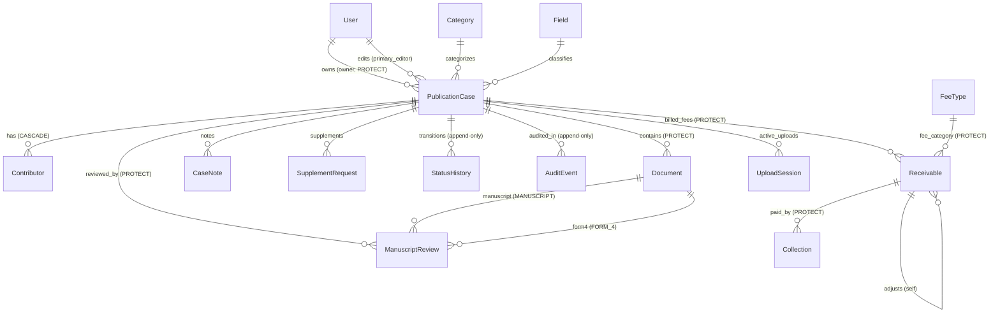

# MÔ HÌNH DỮ LIỆU LÕI (DATA MODEL — M0)

Mọi model nghiệp vụ được khai báo tập trung trong `apps/accounts/models.py` và `apps/core/models.py`.
Mọi bảng đều có `created_at`, `updated_at` tự động và khóa chính `BigAutoField` (trừ `PublicationCase.id` và `UploadSession.id` là `UUIDField`).

> **Cam kết bảo mật dữ liệu cá nhân:** Cơ sở dữ liệu **không lưu số CCCD, ngày cấp, nơi cấp** và **không chứa bất kỳ bảng/trường nào về in ấn, phát hành hay kế toán**.

## 1. Danh mục các bảng dữ liệu

| # | Model | Ứng dụng | Khóa chính | Ghi chú bất biến / nghiệp vụ |
| :-: | :--- | :--- | :--- | :--- |
| 1 | `User` | `apps.accounts` | `BigAutoField` | Đăng nhập bằng `email`, vai trò `CUSTOMER / EDITOR / ADMIN`, `finance_access: NONE / VIEW / MANAGE` |
| 2 | `Category` | `apps.core` | `BigAutoField` | Thể loại sách (`name`, `is_active`, `sort_order`) |
| 3 | `Field` | `apps.core` | `BigAutoField` | Lĩnh vực chuyên môn cho Mẫu 5 |
| 4 | `FeeType` | `apps.core` | `BigAutoField` | Loại phí dịch vụ xuất bản (chỉ phí xuất bản/biên tập/khác) |
| 5 | `PublicationCase` | `apps.core` | `UUIDField` | 1 hồ sơ = 1 đầu sách; `display_code = isbn \|\| nxb_code \|\| temp_code`; `nxb_code` bất biến |
| 6 | `Contributor` | `apps.core` | `BigAutoField` | Tác giả thư mục (không liên kết `User`, không có quyền) |
| 7 | `Document` | `apps.core` | `BigAutoField` | Không xóa, không ghi đè; tăng `version` theo `(case, doc_type, form_code)` |
| 8 | `ManuscriptReview` | `apps.core` | `BigAutoField` | Ràng buộc `manuscript.case == form4.case == case` và đúng `doc_type` |
| 9 | `CaseNote` | `apps.core` | `BigAutoField` | `visibility`: `INTERNAL` hoặc `CUSTOMER` |
| 10 | `SupplementRequest` | `apps.core` | `BigAutoField` | Yêu cầu bổ sung `OPEN / RESOLVED` |
| 11 | `StatusHistory` | `apps.core` | `BigAutoField` | Chỉ ghi thêm (append-only) |
| 12 | `FormTemplate` | `apps.core` | `BigAutoField` | Nhiều phiên bản theo `code`, trang công khai lấy bản `is_active` mới nhất |
| 13 | `CodeSequence` | `apps.core` | `BigAutoField` | Duy nhất theo `(prefix, year)`, khóa dòng `select_for_update()` |
| 14 | `AuditEvent` | `apps.core` | `BigAutoField` | Chỉ ghi thêm; chặn `save()` cập nhật và chặn `delete()` |
| 15 | `Receivable` | `apps.core` | `BigAutoField` | Khoản phải thu phí dịch vụ xuất bản; không xóa, sửa bằng bút toán điều chỉnh |
| 16 | `Collection` | `apps.core` | `BigAutoField` | Khoản đã thu theo `Receivable`; không xóa, sửa bằng bút toán đảo |
| 17 | `UploadSession` | `apps.core` | `UUIDField` | Phiên tải chia phần ≤ 8 MiB, hết hạn sau 24 giờ |

## 2. Sơ đồ quan hệ thực thể (Mermaid ER Diagram)

